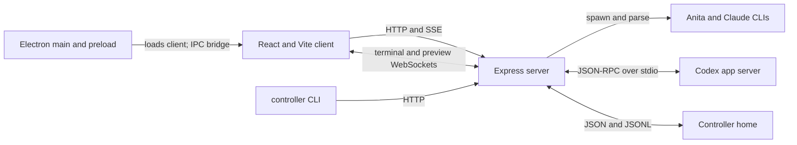
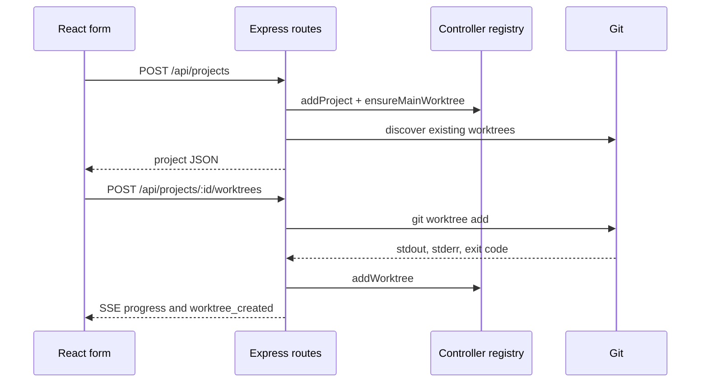

# From a prompt to a persisted conversation: a tour of Controller

Controller looks like a chat app, but a message crosses several boundaries before it appears in the transcript: a React view, an Express route, a provider process, a normalized event stream, and an on-disk log. Following that message is a useful way to understand the repository. This tour uses the current implementation as its map; paths linked below point to the code behind each claim.

## The five pieces

The [root package](../package.json) builds a Vite/React client, a TypeScript Express server, shared TypeScript modules, and an Electron runtime. The dependency-free [agent-facing CLI](../cli/controller) is copied into the build by [the build script](../cli/copy-cli.mjs). These pieces have distinct jobs:

| Piece | Main entry points | Responsibility |
| --- | --- | --- |
| Client | [App](../client/src/App.tsx), [SessionView](../client/src/pages/SessionView.tsx), [API helpers](../client/src/api.ts) | Navigation, composer, live transcript, files and terminal views |
| Server routes | [index](../server/index.ts), [projects](../server/routes/projects.ts), [worktrees](../server/routes/worktrees.ts), [sessions](../server/routes/sessions.ts) | HTTP/SSE/WebSocket boundaries, validation, run orchestration |
| Server libraries | [agents](../server/lib/agents.ts), [Codex app server](../server/lib/codex-app-server.ts), [sessions](../server/lib/sessions.ts), [paths](../server/lib/paths.ts) | Provider adapters, runtime state, persistence, storage layout |
| Shared | [event dedupe](../shared/events-dedupe.ts), [pagination](../shared/events-pagination.ts), [Electron bridge contract](../shared/controller.ts) | Rules and types used on both sides of a boundary |
| Desktop and CLI | [Electron main](../electron/main.ts), [preload](../electron/preload.ts), [controller CLI](../cli/controller) | Desktop shell and an HTTP client that agents can invoke |



The server mounts the project, worktree, session, and project-event routers under `/api/projects`; it also owns WebSocket upgrade routing for terminals and the preview browser ([`server/index.ts`](../server/index.ts)). Electron loads the Vite URL during development; a packaged app starts the compiled server and loads its built client ([`electron/main.ts`](../electron/main.ts)). The preload exposes a typed `window.controller` bridge for desktop-only actions such as picking a directory ([`electron/preload.ts`](../electron/preload.ts), [`shared/controller.ts`](../shared/controller.ts)).

## First boundary: a directory becomes a project

The add-project form calls `createProject(name, path, setupCommands, runCommands)` ([`ProjectSetup.tsx`](../client/src/pages/ProjectSetup.tsx)). Its API helper sends JSON to `POST /api/projects` ([`client/src/api.ts`](../client/src/api.ts)). The route writes a project registry record, ensures a main-worktree row, reconciles existing Git worktrees, and emits `project_added` for other windows ([`server/routes/projects.ts`](../server/routes/projects.ts)). The project record stores identity and path; setup/run commands are read from the project's script files when a project is hydrated ([`server/lib/projects.ts`](../server/lib/projects.ts), [`server/lib/project-scripts.ts`](../server/lib/project-scripts.ts)).

```ts
// server/routes/projects.ts, shortened to the core sequence
const project = await addProject(name, path, setupCommands, runCommands);
await ensureMainWorktree(project);
try {
  await reconcileGitWorktrees(project);
} catch (error) {
  console.error(`Failed to discover Git worktrees for ${project.path}:`, error);
}
emitProjectEvent({ type: "project_added", project });
res.status(201).json(project);
```

A new worktree follows a more involved path. `POST /api/projects/:projectId/worktrees` checks the name and rejects reuse of even a removed worktree's name, because that name maps to the same checkout path and could mix old and new conversation storage. It resolves a base ref, streams Git output back to the caller, runs `git worktree add`, records the row, emits `worktree_created`, and runs configured setup commands when present ([`server/routes/worktrees.ts`](../server/routes/worktrees.ts)). The client API represents that streaming response as an `AsyncIterable<WorktreeCreateEvent>` plus a final `result` promise ([`client/src/api.ts`](../client/src/api.ts)). Controller-created worktrees live under `worktrees/<projectId>/<name>` in the Controller home ([`server/lib/paths.ts`](../server/lib/paths.ts)).

The project and worktree registries are separate from Git's own list. `reconcileGitWorktrees` discovers external Git worktrees and updates Controller's view; the registry also tracks Controller metadata such as IDs and removed rows ([`server/lib/worktrees.ts`](../server/lib/worktrees.ts)). This lets the sidebar show a stable object even though the underlying Git checkout may change independently.



## A turn is a stream and a durable record

For an interactive turn, `SessionView` calls `startSession`, which opens an `EventSource` on `GET /api/projects/:projectId/sessions/stream` with the message, worktree ID, provider, and optional resume ID ([`client/src/pages/SessionView.tsx`](../client/src/pages/SessionView.tsx), [`client/src/api.ts`](../client/src/api.ts)). The server resolves the project and worktree, rejects unavailable worktrees, checks cross-worktree session collisions on resume, selects provider settings, and starts the run ([`server/routes/sessions.ts`](../server/routes/sessions.ts)).

The headless `POST /api/projects/:projectId/sessions` takes the same underlying stream path through a response shim. It returns a session ID after the first `run.started`, while the run continues and persists without a browser-held SSE connection. The [Controller CLI](../cli/controller) uses this route for `sessions start`; queued follow-up turns also use a headless stream response ([`server/routes/sessions.ts`](../server/routes/sessions.ts), [`server/lib/session-start.ts`](../server/lib/session-start.ts)).

```mermaid
sequenceDiagram
  participant View as SessionView
  participant Route as Session route
  participant Provider as Provider adapter
  participant Disk as Session JSON and events JSONL
  View->>Route: GET /sessions/stream?message=...&worktreeId=...
  Route->>Provider: start turn in worktree cwd
  Provider-->>Route: run.started and normalized events
  Route->>Disk: save session; append user_message
  Route->>Disk: append normalized events in order
  Route-->>View: SSE anita_event envelopes
  View->>Route: GET /sessions/:id/events on reload
  Route->>Disk: read transcript
  Route-->>View: persisted events
```

The provider interface is `AgentProvider`, and adapters map provider output into `AgentStreamEvent` variants such as `run.started`, `assistant.text`, `tool.call`, and `tool.result` ([`server/lib/agents.ts`](../server/lib/agents.ts)). Anita and Claude spawn child processes with their worktree as `cwd`; Anita emits stream JSON and Claude emits stream JSON through its CLI. The spawn helper isolates POSIX process groups so signals to a descendant tree do not reach Controller's own process group ([`server/lib/agents.ts`](../server/lib/agents.ts)).

Codex takes a different execution path. `startSessionStream` dispatches Codex turns to `streamCodexPlanSession`, which uses `CodexAppServerManager`. That manager starts or resumes a thread and calls `turn/start` over JSON-RPC, with input, model, approval and sandbox settings, and working directory ([`server/routes/sessions.ts`](../server/routes/sessions.ts), [`server/lib/codex-app-server.ts`](../server/lib/codex-app-server.ts)). All three providers still reach the same normalized UI event vocabulary. The adapter boundary matters when adding provider-specific behavior: transport differences stay near the provider; transcript rendering consumes common events.

The route writes an initial `user_message` when the run's session ID becomes known, merges the session JSON record, then appends later normalized events to JSONL. Event writes run through an awaited `eventProcessing` chain, preserving stream order on disk. Some transient status and plan-delta events are sent live but deliberately excluded from the persisted transcript ([`server/routes/sessions.ts`](../server/routes/sessions.ts)). A compact version of the storage operation is:

```ts
// server/lib/sessions.ts
export async function appendEvent(
  projectPath: string,
  sessionId: string,
  event: AgentEvent
): Promise<void> {
  const filePath = eventsFilePath(projectPath, sessionId);
  await fs.mkdir(path.dirname(filePath), { recursive: true });
  await fs.appendFile(filePath, JSON.stringify(event) + "\n");
}
```

`projectPath` here is the **selected worktree path** at the route call site. `projectStoreDir` hashes that absolute path, so the main checkout and each worktree get distinct `sessions/`, `events/`, and lazily created `attachments/` directories beneath the Controller home ([`server/lib/paths.ts`](../server/lib/paths.ts), [`server/lib/sessions.ts`](../server/lib/sessions.ts)). This keeps Controller's transcript out of the checkout and avoids colliding with Anita's own `.coding-agent` storage. Safe-ID checks guard file-name components ([`server/lib/paths.ts`](../server/lib/paths.ts)).

## From events to pixels

The live SSE envelope is `{ type: "anita_event", event }` for normalized provider events, despite the historical envelope name. `SessionView` handles `run.started` by attaching the view to the session ID, and maps text, reasoning, tool calls, and tool results into stream items. It checks whether the initiating session is still visible before changing the displayed transcript, so a background run cannot overwrite another open conversation ([`server/routes/sessions.ts`](../server/routes/sessions.ts), [`client/src/pages/SessionView.tsx`](../client/src/pages/SessionView.tsx), [`client/src/lib/session-stream-visibility.ts`](../client/src/lib/session-stream-visibility.ts)).

On reload, the view reads `GET /api/projects/:projectId/sessions/:sessionId/events`. Without a limit, the route returns the full transcript after deduplicating adjacent user-message echoes. With `limit` and optional `before`, it returns a raw tail page; the client stitches pages and applies the shared dedupe rule across the seam ([`server/routes/sessions.ts`](../server/routes/sessions.ts), [`client/src/api.ts`](../client/src/api.ts), [`shared/events-dedupe.ts`](../shared/events-dedupe.ts), [`shared/events-pagination.ts`](../shared/events-pagination.ts)). This is why the event log is more than a debug artifact: it reconstructs the chat after the stream has closed.

There is a second SSE channel for project lifecycle events. `/api/projects/:projectId/events` delivers worktree/session changes for that project and broadcasts project create/update/delete events to subscribed projects. `App` subscribes and refetches sidebar data in response ([`server/routes/events.ts`](../server/routes/events.ts), [`server/lib/events.ts`](../server/lib/events.ts), [`client/src/App.tsx`](../client/src/App.tsx)). Run output and sidebar invalidation therefore have separate consumers.

## Why the extra machinery exists

- **Identity spans two systems.** Ordinary sessions use the provider thread ID as the Controller session ID. A branched session owns a Controller UUID while `providerThreadId` records the new provider thread for later resumes. The route keeps those identities separate and rejects resuming an existing session from another worktree's store ([`server/routes/sessions.ts`](../server/routes/sessions.ts)).
- **A browser is optional during execution.** The headless start shim and queue consumer use the same run path as the interactive stream. `advanceSessionQueue` starts the next message with a discarding response; completed runs drain the queue even if no tab is listening ([`server/routes/sessions.ts`](../server/routes/sessions.ts), [`server/lib/session-queue.ts`](../server/lib/session-queue.ts)).
- **Controller state has its own location.** `CONTROLLER_HOME` overrides the platform default. Registries and per-checkout transcript stores live there; focus state is a separate sidecar so updating a session record cannot erase a focus pin ([`server/lib/paths.ts`](../server/lib/paths.ts), [`server/lib/sessions.ts`](../server/lib/sessions.ts)).
- **The CLI is an API client.** `cli/controller` discovers the server URL and sends HTTP requests for projects, worktrees, sessions, skills, integrations, and other agent actions. Its absolute install path is supplied in the agent preamble because a provider shell may not retain Controller's `PATH` ([`cli/controller`](../cli/controller), [`server/lib/agent-preamble.ts`](../server/lib/agent-preamble.ts)).

## Working in the repository

The root [package scripts](../package.json) provide `npm run dev` for Vite plus the API server, `npm run dev:electron` for the desktop shell, `npm run build` for the client/server/shared/Electron output, and `npm test` for the Node test suites. The separate [docs package](../docs/package.json) builds the public Next/Fumadocs site. The [building guide](content/docs/building-from-source.mdx) covers prerequisites and setup.

For a focused change, follow the boundary it crosses. A new provider event usually means updating the adapter in [`server/lib/agents.ts`](../server/lib/agents.ts) or [`server/lib/codex-app-server.ts`](../server/lib/codex-app-server.ts), the persistence mapping in [`server/routes/sessions.ts`](../server/routes/sessions.ts), and the rendering branch in [`client/src/pages/SessionView.tsx`](../client/src/pages/SessionView.tsx). A new worktree operation belongs in [`server/routes/worktrees.ts`](../server/routes/worktrees.ts), with registry behavior in [`server/lib/worktrees.ts`](../server/lib/worktrees.ts) and a typed client call in [`client/src/api.ts`](../client/src/api.ts). Shared rules such as event deduplication should live in [`shared/`](../shared/events-dedupe.ts) when both server and client must agree.

The central mental model is simple: a **project** identifies a repository, a **worktree** selects the checkout and storage namespace, a **session** records identity and current metadata, and an **event log** records the conversation. Provider adapters turn external execution into common events; the UI renders the live stream and can rebuild it from disk later.
